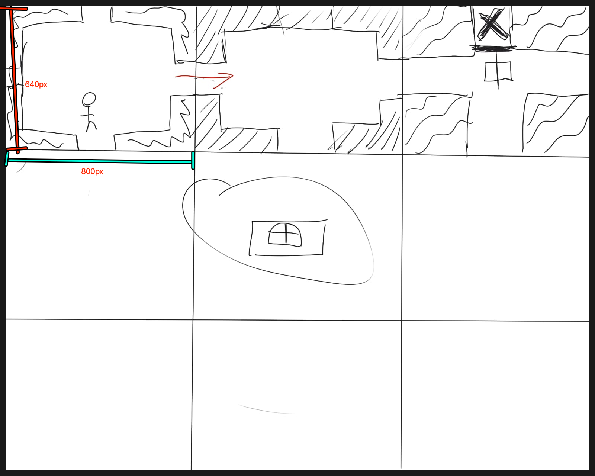
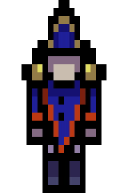

# Diseño del juego — Fuga del Real Felipe

> Documento principal de diseño. Reemplaza al borrador anterior del compañero
> ([`referencia/borrador-qte-companero.md`](referencia/borrador-qte-companero.md)), de donde se
> conservan la ambientación histórica y la idea de la cámara lenta con la palabra a decir.
> El título del juego es provisional.

## 1. Idea en una frase

Un juego de acción **top-down** parecido a _The Binding of Isaac_: el jugador explora salas llenas
de enemigos, abre cofres que lo mejoran y, con la **voz**, deletrea palabras para lanzar poderes
y sobrevivir a los ataques más fuertes del jefe del piso.

## 2. Pilares de diseño

1. **Acción clara y rápida.** Moverse, apuntar con el ratón y disparar debe sentirse bien desde el
   primer minuto.
2. **La voz es una mecánica, no un adorno.** Deletrear una palabra bajo presión es el momento más
   tenso y más especial del juego.
3. **Riesgo y recompensa.** Cada sala tiene un cofre que mejora al personaje; la llave del jefe
   está escondida en uno de ellos.
4. **Basado en hechos reales.** El escenario (la Fortaleza del Real Felipe, sitio del Callao,
   1824–1826) y las palabras que se deletrean vienen de la historia real.

Qué pide la tarea y dónde se cumple cada punto: [`requisitos-de-la-tarea.md`](requisitos-de-la-tarea.md).

## 3. Ambientación

Se mantiene la del borrador del equipo: **ficción históricamente inspirada** en el sitio del Callao
(1824–1826), cuando la Fortaleza del Real Felipe resistió bajo el mando realista de José Ramón
Rodil incluso después de la capitulación española en Ayacucho. Cayó en enero de 1826.

- **Real:** la fortaleza, el asedio, el hambre, las enfermedades y la resistencia de Rodil.
- **Ficticio:** el protagonista, los enemigos concretos y los eventos de la fuga.
- Al final del juego se incluye una **nota histórica breve** que aclara qué es real y qué es
  ficción.
- El primer piso es una prisión (celdas, barras metálicas, cajas de madera). El segundo piso está
  pendiente de definir (ver [`decisiones-pendientes.md`](decisiones-pendientes.md)).

## 4. Estructura de un nivel

Cada nivel (piso) es un **lienzo de 3×3 habitaciones**. Cada habitación mide **800×640 px**, así
que el mapa completo mide **2400×1920 px**, que es también el tamaño de cada fondo.

```
        columna 0       columna 1       columna 2
      ┌───────────────┬───────────────┬───────────────┐
fila 0│  Sala 0,0     │  Sala 1,0     │  Sala 2,0     │
      │  (inicio ★)   │               │               │
      ├───────────────┼───────────────┼───────────────┤
fila 1│  Sala 0,1     │  SALA DEL     │  Sala 2,1     │
      │               │  JEFE  🔒     │               │
      ├───────────────┼───────────────┼───────────────┤
fila 2│  Sala 0,2     │  Sala 1,2     │  Sala 2,2     │
      └───────────────┴───────────────┴───────────────┘
        ★ = posible punto de partida (según el boceto; por confirmar)
```

- Las **8 salas de alrededor** tienen cada una **un enemigo débil y un cofre**.
- La **sala central** es la del **jefe** del nivel y empieza cerrada con llave.
- La posición de una sala en el mundo es `x = columna × 800`, `y = fila × 640`.
- La cámara muestra **una sala a la vez**: al cruzar una puerta salta a la sala vecina.



### 4.1 Cómo se recorre

```
Entrar a una sala → vencer al enemigo débil → abrir el cofre → mejorar al personaje
        → pasar a otra sala → ... → conseguir la llave → abrir la sala central
        → vencer al jefe (deletreando) → pasar al siguiente piso
```

Las 8 salas forman un **anillo**: se avanza de una a la vecina por las puertas. Qué puertas
existen exactamente entre salas es una decisión de nivel (ver §4.3).

### 4.2 La llave del jefe

Los cofres tienen **1/8 de probabilidad** de dar la llave, y **tiene que salir sí o sí** en uno
de los 8 cofres. Para cumplir las dos reglas a la vez, el nivel se prepara así:

1. Al empezar el nivel se elige **una de las 8 salas al azar** (todas con la misma probabilidad).
2. El cofre de esa sala es el que contiene la llave.

Para el jugador, cada cofre sigue teniendo una probabilidad de 1/8, pero la llave **nunca falta**.
Si el jugador abre todos los cofres, siempre la encuentra.

### 4.3 Puertas y conexiones (propuesta)

- Cada sala se conecta con sus vecinas del anillo.
- La sala central tiene **una puerta cerrada** hacia el jefe; la llave abre esa puerta (y no se
  gasta si el jugador sale y vuelve a entrar).
- Una sala con enemigo **bloquea sus puertas** hasta que el enemigo muere (como en _Isaac_).

## 5. Fondos y arte

| Nivel    | Fondo                                                                      | Estado    |
| -------- | -------------------------------------------------------------------------- | --------- |
| Piso 1   | 2400×1920 px. Piso de piedra, barras metálicas y cajas de madera (prisión) | Definido  |
| Piso 2   | 2400×1920 px                                                               | Pendiente |
| (Piso 3) | 2400×1920 px                                                               | Pendiente |

Los **compañeros dibujan los sprites y fondos finales**. Mientras tanto el equipo de lógica
trabaja con **recursos genéricos y simples** (rectángulos de colores generados por código) que se
reemplazan después sin cambiar la lógica. Cómo se hace y qué tamaños pedir:
[`guia-de-recursos.md`](guia-de-recursos.md).

Sprite actual del jugador (provisional):



## 6. Cofres y recompensas

### 6.1 Cofres comunes

Dan una mejora permanente para el resto de la partida:

| Mejora    | Efecto                             |
| --------- | ---------------------------------- |
| Vida      | Aumenta la vida máxima             |
| Ataque    | Aumenta el daño de las balas       |
| Velocidad | Aumenta la velocidad de movimiento |

Los valores concretos (+1 corazón, +10 % de daño, etc.) se ajustan con pruebas de juego y viven en
`src/datos/recompensas.js`.

### 6.2 Cofres especiales

| Recompensa      | Efecto                                                                                            |
| --------------- | ------------------------------------------------------------------------------------------------- |
| **Revivir**     | Al perder toda la vida, revives con la vida inicial y tienes **2 segundos de inmunidad**.         |
| **PasaPalabra** | Permite atacar **sin deletrear bien** la palabra. Se tiene **1 uso cada 4 palabras** deletreadas. |
| **DobleDash**   | El dash se puede usar **2 veces seguidas** y las dos usan el **mismo tiempo de recarga**.         |

Dónde y cómo aparecen los cofres especiales está pendiente de decidir
([`decisiones-pendientes.md`](decisiones-pendientes.md)).

## 7. Enemigos y jefe

- **Enemigo débil** (uno por sala de alrededor): poca vida y un comportamiento simple. Es el
  enemigo que se usa para aprender a moverse y disparar. Comportamiento exacto por definir.
- **Jefe del nivel** (sala central): tiene ataques básicos que se pueden esquivar moviéndose y
  **ataques fuertes que no se pueden esquivar con el movimiento**: para evitarlos hay que
  deletrear una palabra mientras el mundo va en cámara lenta (ver
  [`mecanicas.md`](mecanicas.md), sección "Ataque fuerte del jefe").

## 8. Flujo de una partida

```
Portada → Nivel 1 (8 salas + jefe) → Nivel 2 (8 salas + jefe) → Pantalla final + nota histórica
              ↑ efectos y sonido en todo el juego ↑
```

Si el jugador muere (y no tiene **Revivir**), vuelve a la portada o reinicia el nivel (por decidir).

## 9. Alcance

**Imprescindible (lo que pide la tarea):** portada, 2 niveles, control de voz, sonidos, efectos,
multijugador y aplicar los principios de calidad total.

**Si alcanza el tiempo:** tercer piso, más tipos de enemigos, más poderes de voz, más cofres
especiales, ranking de puntajes.
