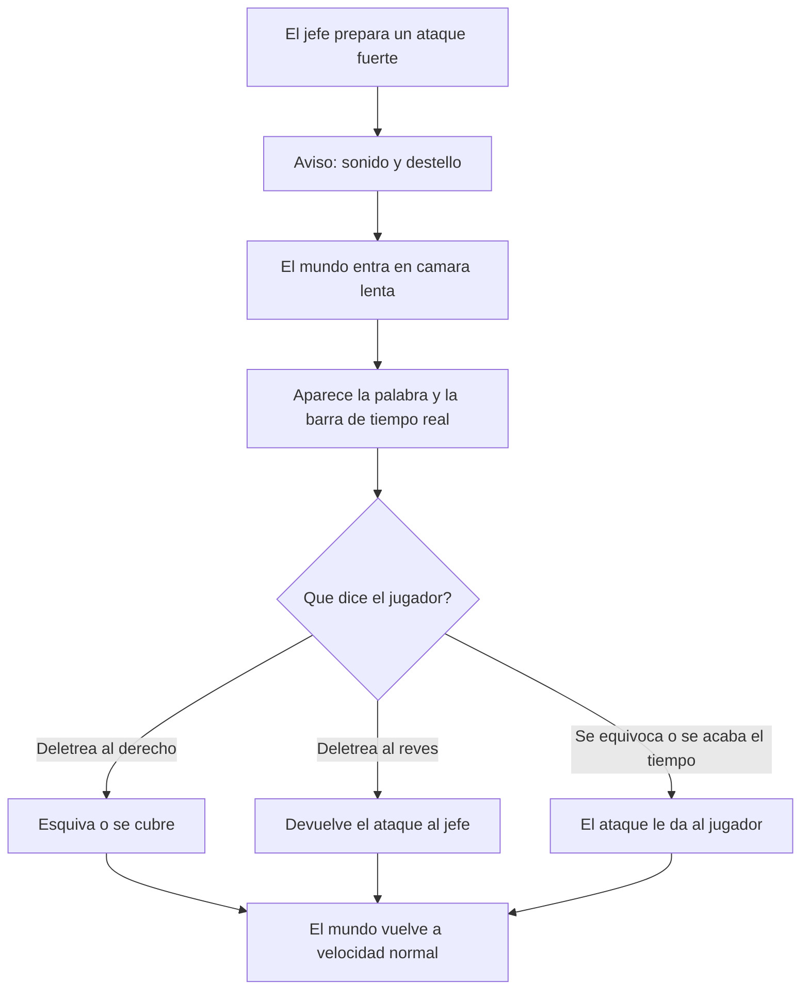

# Mecánicas

Cómo funciona el juego "por dentro". Para la visión general, mira
[`diseno-del-juego.md`](diseno-del-juego.md). Los números de este documento son **propuestas
iniciales**: se ajustan jugando y viven en `src/config.js` o en `src/datos/`.

## 1. Controles

| Acción       | Control                                                      | Estado              |
| ------------ | ------------------------------------------------------------ | ------------------- |
| Moverse      | Flechas **o** W A S D                                        | Definido            |
| Apuntar      | Ratón (el personaje mira hacia el cursor)                    | Definido            |
| Disparar     | Clic, varios clics o mantener pulsado el clic                | Definido            |
| Disparo auto | Opción para que dispare solo mientras apuntas                | Por decidir         |
| Dash         | Barra espaciadora (una pulsación por dash)                   | Hecho (provisional) |
| Voz          | El micrófono se activa solo cuando hay una palabra que decir | Definido            |

## 2. Movimiento y disparo

- Movimiento top-down de **8 direcciones**, con velocidad constante (se ajusta con las mejoras de
  velocidad). En diagonal se normaliza el vector para no ir más rápido.
- Las balas salen hacia el cursor. Hay una **cadencia** (tiempo mínimo entre disparos) y un **daño**
  por bala; las mejoras de ataque suben el daño.
- Las balas desaparecen al chocar con una pared o con un enemigo, o al salir de la sala.

## 3. Dash

- Un impulso corto en la dirección en que se mueve el jugador. Si está quieto, va hacia donde mira.
  Mientras dura no se puede cambiar de rumbo, y deja una estela azul.
- Valores iniciales (en `src/config.js`, sección `DASH`): dura **150 ms** (unos 100 px) y se
  recarga en **1,2 s**.
- Durante el dash el jugador es **inmune** (200 ms, un poco más que el impulso). Provisional.
- **DobleDash:** el dash se puede usar 2 veces seguidas y las dos usan **el mismo tiempo de
  recarga** (una sola barra de recarga, dos cargas). Se interpreta así: hay **un solo
  temporizador**, que empieza con el primer uso. El segundo uso no lo reinicia: cuando se cumple
  la recarga contada desde el primer uso, vuelven las dos cargas.
- El HUD muestra una pastilla por carga y una barra que se llena al recargar.
- La lógica está en `src/sistemas/Dash.js` (pura, con pruebas en `pruebas/dash.test.js`).
  Todavía no hay forma de conseguir el DobleDash jugando: llega con los cofres especiales.

## 4. Estadísticas del jugador

| Estadística | Para qué sirve          | La sube            |
| ----------- | ----------------------- | ------------------ |
| Vida        | Cuántos golpes aguanta  | Cofre de vida      |
| Ataque      | Daño de cada bala       | Cofre de ataque    |
| Velocidad   | Velocidad de movimiento | Cofre de velocidad |

## 5. Control de voz: deletrear palabras

La voz sirve para **deletrear** una palabra, letra por letra. Ejemplo: para decir **FERROCARRIL**
el jugador dice _efe, e, ere, ere, o, ce, a, ere, ere, i, ele_.

### 5.1 Dónde se usa

| Uso                                  | Qué pasa                                                                |
| ------------------------------------ | ----------------------------------------------------------------------- |
| Poder especial del jugador (granada) | Al deletrear la palabra se lanza el poder. _Falta definir los poderes._ |
| Ataque fuerte del jefe               | Hay que deletrear para esquivar, cubrirse o devolver el golpe           |

### 5.2 Flujo de una palabra

1. El juego muestra la **palabra** y una **barra de tiempo**.
2. Se activa el **micrófono** (la primera vez, el navegador pide permiso).
3. El jugador deletrea. Cada letra reconocida se **ilumina** en pantalla.
4. Si completa la palabra a tiempo → **acierto**. Si se equivoca o se acaba el tiempo → **fallo**.

### 5.3 Cómo se compara lo que se dijo

El reconocimiento de voz devuelve texto, no letras. Por eso hace falta un paso de **normalización**:

1. Pasar a minúsculas y quitar tildes y signos.
2. Convertir los **nombres de las letras** a la letra (_efe → f_, _ere → r_, _doble ve → w_,
   _eñe → ñ_) y aceptar también la letra suelta (_f_, _r_).
3. Comparar la secuencia obtenida con la palabra esperada, aceptando un **margen de error
   pequeño** (por ejemplo, 1 letra de diferencia en palabras largas).

Esta lógica es **pura** (texto entrante → acierto sí/no) y por eso se puede probar con tests
automáticos sin micrófono. Va en `src/utilidades/deletreo.js`.

### 5.4 Palabras al revés

Para **devolver un ataque** del jefe hay que deletrear la palabra **al revés** (por ejemplo
_L I R R A C O R R E F_). Es más difícil, así que da más recompensa: devolver el golpe hace daño
al jefe.

### 5.5 Banco de palabras

Las palabras salen de la historia real del sitio del Callao, para que el juego "genere impacto"
y enseñe algo. Ejemplos por dificultad (por validar con pruebas de voz):

| Dificultad | Palabras de ejemplo                                  |
| ---------- | ---------------------------------------------------- |
| Fácil      | RODIL, CALLAO, FUERTE, CAÑÓN                         |
| Media      | FORTALEZA, BASTIÓN, PÓLVORA, ASEDIO                  |
| Difícil    | CAPITULACIÓN, INDEPENDENCIA, ARTILLERÍA, FERROCARRIL |

Se guardan en `src/datos/palabras.js`. La palabra **no cambia** mientras la barra de tiempo corre.

### 5.6 Riesgos técnicos de la voz

- **Navegadores:** la Web Speech API funciona en Chrome, Edge y Safari, pero **no en Firefox**. En
  Chrome el audio normalmente se procesa en servidores de Google, así que **necesita internet**. Hay
  que servir el juego desde `localhost` o desde HTTPS.
- **Letras sueltas:** los reconocedores están hechos para frases, no para letras. Pueden juntar
  letras en una palabra ("efe e ere" → "fer") o confundirlas (_be_ / _ve_, _ce_ / _se_). Hay que
  **probarlo cuanto antes** (ver el "spike de voz" en [`mapa-del-proyecto.md`](mapa-del-proyecto.md)).
- **Tiempo:** hablar letra por letra es lento. Una palabra de 11 letras puede tardar 8–10 segundos.
  El tiempo de la barra debe calcularse con el largo de la palabra, por ejemplo
  `tiempo = base + letras × tiempoPorLetra`.
- **Modo teclado:** además del micrófono, un modo de **respaldo con teclado** (teclear la
  palabra) sirve para desarrollar y probar sin hablar, y para quien no tenga micrófono. El juego no
  debe quedarse bloqueado si el micrófono falla. **Ya está hecho** (paso 7); ver más abajo.

### 5.7 Cómo funciona hoy el deletreo con teclado

- **Provisional:** la tecla **E** pide una palabra al azar y **R** una fácil al revés. Cuando el
  deletreo sea un poder (paso 9) se activará desde el juego.
- Aparece una pantalla encima del juego con la palabra, las letras acertadas en verde, la que toca
  subrayada y una **barra de tiempo**. La barra mide el **tiempo real** (`performance.now()`), no el
  del juego, para que la cámara lenta del jefe no la estire.
- **Tiempo:** `1,5 s + 0,4 s por letra` (una palabra de 11 letras da 5,9 s). Al revés se da **1,5 veces**
  ese tiempo.
- **Errores:** se perdonan **2** letras equivocadas; con la tercera se falla. Una letra equivocada
  no avanza la palabra. Lo que no es una letra (Shift, números, espacio) se ignora.
- Las **tildes y mayúsculas no importan**, pero la **Ñ sí**: escribir N no cuenta como Ñ.
- Mantener una tecla pulsada no repite la letra: cada letra necesita una pulsación nueva.
- Mientras se deletrea el jugador **no puede moverse ni hacer dash** (las letras W, A, S y D son
  las teclas de caminar), pero el juego **sigue**: los enemigos no esperan.
- Al terminar, la pantalla muestra el resultado (**acertada**, **fallada** o **tiempo agotado**) y el
  juego recibe el evento `deletreo-terminado` con ese resultado.
- La lógica es pura y tiene pruebas: `src/utilidades/deletreo.js`, `src/sistemas/Deletreo.js` y
  `pruebas/deletreo.test.js`. El modo de voz (paso 8) mandará sus letras al mismo lugar.

## 6. Ataque fuerte del jefe

El jefe tiene ataques básicos (que se esquivan moviéndose) y **ataques fuertes**. Un ataque fuerte
**siempre le cae al jugador** salvo que este deletree bien la palabra. El movimiento no lo evita.

### 6.1 Cámara lenta

- El mundo (enemigos, balas, animaciones) baja a **0.2x** con una rampa suave de entrada de
  100–150 ms.
- La **barra de tiempo corre en tiempo real**, no en tiempo de juego: el mundo se estira, el tiempo
  del jugador no. En Phaser esto significa que la barra **no puede usar** `time.timeScale`; se mide
  con el reloj real del navegador (`performance.now()`).
- Al acertar, el mundo vuelve a velocidad normal en unos 200 ms y el control se devuelve de
  inmediato.

### 6.2 Reglas de justicia

- El ataque fuerte nunca empieza en mitad de una transición de sala.
- La palabra no cambia mientras corre la barra.
- El fallo se entiende: se ve el golpe y el daño en pantalla.
- El tiempo debe alcanzar para deletrear la palabra de forma realista.

## 7. Cofres especiales

### 7.1 Revivir

Cuando la vida llega a 0, el jugador revive con la **cantidad inicial de vida** y tiene **2 s de
inmunidad**. Se gasta al usarse (por confirmar si se puede acumular).

### 7.2 PasaPalabra

Permite **atacar sin deletrear la palabra correctamente**. Funciona **1 vez cada 4 palabras**:
cada 4 palabras deletreadas se gana un uso. Hay que confirmar si es un uso que se acumula y qué
pasa si se activa por error.

### 7.3 DobleDash

Ver la sección "Dash".

## 8. Efectos y sonido

La tarea pide **efectos** y **sonidos**. Lista inicial (se amplía):

| Tipo    | Ejemplos                                                                                                          |
| ------- | ----------------------------------------------------------------------------------------------------------------- |
| Efectos | Temblor de pantalla al recibir daño, destello al golpear, partículas al morir un enemigo, viñeteado, cámara lenta |
| Sonido  | Disparo, golpe, cofre, puerta, música de cada piso, aviso del ataque fuerte, acierto y fallo de voz               |
