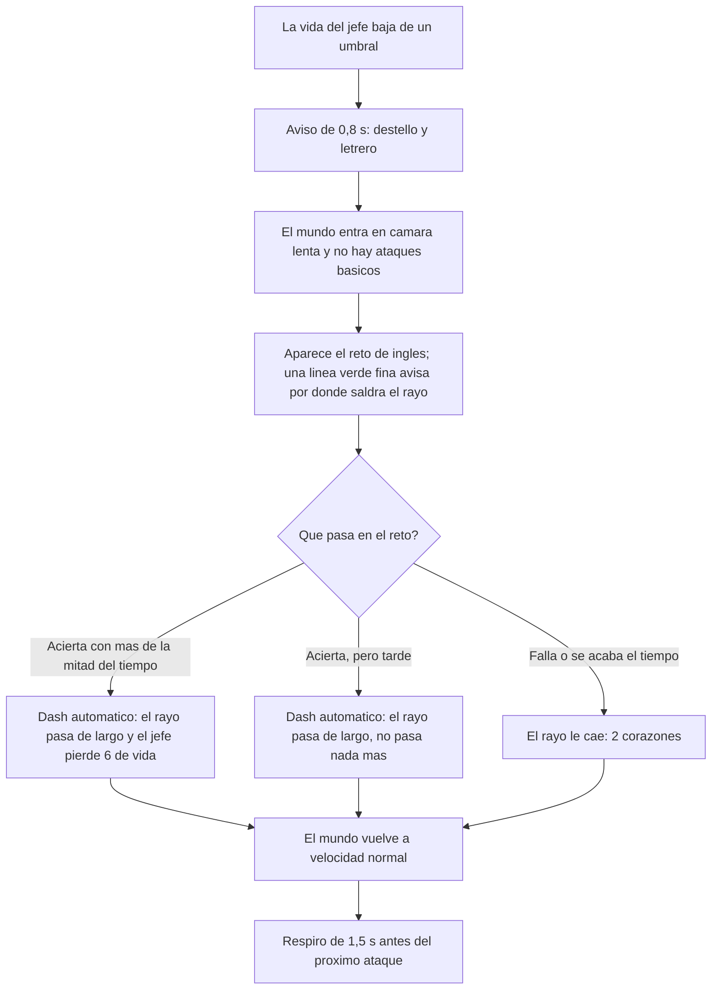

# Mecánicas

Cómo funciona el juego "por dentro". Para la visión general, mira
[`diseno-del-juego.md`](diseno-del-juego.md). Los números de este documento son **propuestas
iniciales**: se ajustan jugando y viven en `src/config.js` o en `src/datos/`.

## 1. Controles

| Acción       | Control                                                      | Estado              |
| ------------ | ------------------------------------------------------------ | ------------------- |
| Moverse      | Flechas **o** W A S D                                        | Definido            |
| Apuntar      | Ratón (el personaje mira hacia el cursor)                    | Definido            |
| Disparar     | Clic, varios clics o mantener pulsado el clic                | Definido            |
| Disparo auto | Opción para que dispare solo mientras apuntas                | Por decidir         |
| Dash         | Barra espaciadora (una pulsación por dash)                   | Hecho (provisional) |
| Voz          | El micrófono se activa solo cuando hay una palabra que decir | Definido            |

## 2. Movimiento y disparo

- Movimiento top-down de **8 direcciones**, con velocidad constante (se ajusta con las mejoras de
  velocidad). En diagonal se normaliza el vector para no ir más rápido.
- Las balas salen hacia el cursor. Hay una **cadencia** (tiempo mínimo entre disparos) y un **daño**
  por bala; las mejoras de ataque suben el daño.
- Las balas desaparecen al chocar con una pared o con un enemigo, o al salir de la sala.

## 3. Dash

- Un impulso corto en la dirección en que se mueve el jugador. Si está quieto, va hacia donde mira.
  Mientras dura no se puede cambiar de rumbo, y deja una estela azul.
- Valores iniciales (en `src/config.js`, sección `DASH`): dura **150 ms** (unos 100 px) y se
  recarga en **1,2 s**.
- Durante el dash el jugador es **inmune** (200 ms, un poco más que el impulso). Provisional.
- **DobleDash:** el dash se puede usar 2 veces seguidas y las dos usan **el mismo tiempo de
  recarga** (una sola barra de recarga, dos cargas). Se interpreta así: hay **un solo
  temporizador**, que empieza con el primer uso. El segundo uso no lo reinicia: cuando se cumple
  la recarga contada desde el primer uso, vuelven las dos cargas.
- El HUD muestra una pastilla por carga y una barra que se llena al recargar.
- La lógica está en `src/sistemas/Dash.js` (pura, con pruebas en `pruebas/dash.test.js`).
  Todavía no hay forma de conseguir el DobleDash jugando: llega con los cofres especiales.

## 4. Estadísticas del jugador

| Estadística | Para qué sirve          | La sube            |
| ----------- | ----------------------- | ------------------ |
| Vida        | Cuántos golpes aguanta  | Cofre de vida      |
| Ataque      | Daño de cada bala       | Cofre de ataque    |
| Velocidad   | Velocidad de movimiento | Cofre de velocidad |

## 5. Control de voz: deletrear palabras

La voz sirve para **deletrear** una palabra, letra por letra. Ejemplo: para decir **FERROCARRIL**
el jugador dice _efe, e, ere, ere, o, ce, a, ere, ere, i, ele_.

### 5.1 Dónde se usa

| Uso                                  | Qué pasa                                                                               |
| ------------------------------------ | -------------------------------------------------------------------------------------- |
| Poder especial del jugador (granada) | Al superar un reto de inglés se lanza el poder (ver 5.11). _Faltan los demás poderes._ |
| Ataque fuerte del jefe               | Hay que deletrear para esquivar, cubrirse o devolver el golpe                          |

### 5.2 Flujo de una palabra

1. El juego muestra la **palabra** y una **barra de tiempo**.
2. Se activa el **micrófono** (la primera vez, el navegador pide permiso).
3. El jugador deletrea. Cada letra reconocida se **ilumina** en pantalla.
4. Si completa la palabra a tiempo → **acierto**. Si se equivoca o se acaba el tiempo → **fallo**.

### 5.3 Cómo se compara lo que se dijo

El reconocimiento de voz devuelve texto, no letras. Por eso hace falta un paso de **normalización**:

1. Pasar a minúsculas y quitar tildes y signos.
2. Convertir los **nombres de las letras** a la letra (_efe → f_, _ere → r_, _doble ve → w_,
   _eñe → ñ_) y aceptar también la letra suelta (_f_, _r_).
3. Comparar la secuencia obtenida con la palabra esperada, aceptando un **margen de error
   pequeño** (por ejemplo, 1 letra de diferencia en palabras largas).

Esta lógica es **pura** (texto entrante → acierto sí/no) y por eso se puede probar con tests
automáticos sin micrófono. Va en `src/utilidades/voz.js` (texto → letras) y `src/utilidades/deletreo.js`.
Lo que se hace hoy:

- Los nombres de las letras están en una **tabla de datos** (`src/datos/nombresDeLetras.js`), fácil de
  ampliar con lo que se vea en la prueba de voz.
- **B y V suenan igual:** "be" y "ve" dan **dos candidatas** (`B`, `V`) y valen para las dos. Solo se
  distinguen con _be larga_, _ve corta_ o _uve_.
- Lo que **no es el nombre de una letra** (por ejemplo, la palabra entera que el navegador se
  inventa) se **ignora**, no cuenta como error.
- Los errores perdonados son los mismos que con el teclado (2).

### 5.4 Palabras al revés

Para **devolver un ataque** del jefe hay que deletrear la palabra **al revés** (por ejemplo
_L I R R A C O R R E F_). Es más difícil, así que da más recompensa: devolver el golpe hace daño
al jefe.

### 5.5 Banco de palabras

Las palabras salen de la historia real del sitio del Callao, para que el juego "genere impacto"
y enseñe algo. Ejemplos por dificultad (por validar con pruebas de voz):

| Dificultad | Palabras de ejemplo                                  |
| ---------- | ---------------------------------------------------- |
| Fácil      | RODIL, CALLAO, FUERTE, CAÑÓN                         |
| Media      | FORTALEZA, BASTIÓN, PÓLVORA, ASEDIO                  |
| Difícil    | CAPITULACIÓN, INDEPENDENCIA, ARTILLERÍA, FERROCARRIL |

Se guardan en `src/datos/palabras.js`. La palabra **no cambia** mientras la barra de tiempo corre.

### 5.6 Riesgos técnicos de la voz

- **Navegadores:** la Web Speech API funciona en Chrome, Edge y Safari, pero **no en Firefox**. En
  Chrome el audio normalmente se procesa en servidores de Google, así que **necesita internet**. Hay
  que servir el juego desde `localhost` o desde HTTPS.
- **Letras sueltas:** los reconocedores están hechos para frases, no para letras. Pueden juntar
  letras en una palabra ("efe e ere" → "fer") o confundirlas (_be_ / _ve_, _ce_ / _se_). Hay que
  **probarlo cuanto antes** (ver el "spike de voz" en [`mapa-del-proyecto.md`](mapa-del-proyecto.md)).
- **Tiempo:** hablar letra por letra es lento. Una palabra de 11 letras puede tardar 8–10 segundos.
  El tiempo de la barra debe calcularse con el largo de la palabra, por ejemplo
  `tiempo = base + letras × tiempoPorLetra`.
- **Modo teclado:** además del micrófono, un modo de **respaldo con teclado** (teclear la
  palabra) sirve para desarrollar y probar sin hablar, y para quien no tenga micrófono. El juego no
  debe quedarse bloqueado si el micrófono falla. **Ya está hecho** (paso 7); ver más abajo.

### 5.7 Cómo funciona hoy el deletreo con teclado (y con voz, ver 5.9)

- **Provisional:** la tecla **E** pide una palabra al azar con la palabra siempre visible, **T** con
  huecos e **Y** de memoria (ver 5.8). Con **Mayúsculas** pulsada se pide **al revés**. **R** pide una
  palabra fácil al revés, siempre visible. **I** pide un **dictado en inglés** (ver 5.8). Cuando el
  deletreo sea un poder (paso 9) se activará desde el juego.
- Aparece una pantalla encima del juego con la palabra, las letras acertadas en verde, la que toca
  subrayada y una **barra de tiempo**. La barra mide el **tiempo real** (`performance.now()`), no el
  del juego, para que la cámara lenta del jefe no la estire.
- **Tiempo:** `1,5 s + 0,4 s por letra` (una palabra de 11 letras da 5,9 s). Al revés se da **1,5 veces**
  ese tiempo.
- **Errores:** se perdonan **2** letras equivocadas; con la tercera se falla. Una letra equivocada
  no avanza la palabra. Lo que no es una letra (Shift, números, espacio) se ignora.
- Las **tildes y mayúsculas no importan**, pero la **Ñ sí**: escribir N no cuenta como Ñ.
- Mantener una tecla pulsada no repite la letra: cada letra necesita una pulsación nueva.
- Mientras se deletrea el jugador **no puede moverse ni hacer dash** (las letras W, A, S y D son
  las teclas de caminar), pero el juego **sigue**: los enemigos no esperan.
- Al terminar, la pantalla muestra el resultado (**acertada**, **fallada** o **tiempo agotado**) y el
  juego recibe el evento `deletreo-terminado` con ese resultado.
- La lógica es pura y tiene pruebas: `src/utilidades/deletreo.js`, `src/sistemas/Deletreo.js` y
  `pruebas/deletreo.test.js`. El modo de voz (paso 8) mandará sus letras al mismo lugar.

### 5.9 Cómo funciona hoy el deletreo con voz

- **Provisional:** la tecla **V** cambia entre teclado y voz. Después se pide la palabra con **E**, **T**
  o **Y** como siempre (5.7 y 5.8). La primera vez, el navegador pide permiso para el micrófono.
- Se usa la **Web Speech API** (`SpeechRecognition`, `webkitSpeechRecognition` en Chrome) con el idioma
  `es-PE` _(provisional)_. Escucha de forma continua y entrega resultados provisionales mientras se
  habla (`src/sistemas/ReconocedorDeVoz.js`).
- El navegador corrige lo que ya dijo y reparte el texto entre varios resultados a la vez. Por eso
  se **unen todos en un solo texto** y se entregan solo las letras nuevas, una sola vez
  (`src/sistemas/AcumuladorDeVoz.js`). Contar cada resultado por separado daba letras de más y
  desordenadas (en la prueba de voz, 41 errores sueltos contra 13 con el texto unido). Guardar la
  última letra hasta el resultado final está **apagado**: costaba ~1,3 s por palabra.
- **Tiempo:** el **doble** que con el teclado (×2; con pausas entre letras se necesitan 0,7–0,85 s por letra). Con el modo al revés los dos factores se
  multiplican.
- Mientras el micrófono está activo, el **teclado se desactiva** (así no hay trampa y W, A, S, D no
  cuentan como errores). Al terminar la palabra el micrófono se apaga.
- **Plan B automático:** si el navegador no tiene reconocimiento de voz, no hay permiso, no hay
  internet o no hay micrófono, la pantalla **pasa sola al teclado** y avisa («Sin micrófono… ¡usa el
  teclado!»). El juego nunca se queda sin forma de deletrear.
- Chrome corta el reconocimiento tras un silencio: se **reinicia solo** mientras se deletrea.
- Abajo del panel se ve lo último que oyó el navegador, para saber si te está entendiendo.
- **Hay que decir las letras con una pequeña pausa.** Si se dicen seguidas, Chrome las junta en una
  palabra («calllao») y no cuentan; decir la palabra entera tampoco la completa (no se puede hacer
  trampa). La única excepción son **dos letras juntas** en una palabra de dos caracteres («fu» por
  «efe u», «il» por «i ele»), que se leen como dos letras. Hay dos ayudas opcionales en `CONFIG.DELETREO.VOZ` (`SESGAR_A_LAS_LETRAS` y
  `PROCESAR_EN_EL_EQUIPO`) que se prueban en la [prueba de voz](prueba-de-voz.md).
- Todo lo que no depende del micrófono tiene pruebas con `npm test` (se usa un reconocimiento falso).
  Lo que sí depende de él se mide con la [prueba de voz](prueba-de-voz.md).

### 5.8 Modos de deletreo (dificultad)

Hay cuatro formas de mostrar la palabra, de menos a más difícil. Los errores perdonados son los mismos
en todas; lo que cambia es **qué ve el jugador** (y, en el dictado, que una voz dice la palabra).

| Modo      | Qué se ve                                                                                                    |
| --------- | ------------------------------------------------------------------------------------------------------------ |
| `visible` | La palabra se ve todo el tiempo.                                                                             |
| `huecos`  | Se ve **una sola vez**; luego solo los huecos (`_ _ _`), como en el **Ahorcado**.                            |
| `memoria` | Se ve **una sola vez**; luego **no queda nada**: hay que recordarla (como en un concurso de deletreo).       |
| `dictado` | **Nunca se ve**: una voz la **dice en inglés** y se escribe con el teclado (nivel 3 de los retos de inglés). |

- **Lectura:** en `huecos` y `memoria` la palabra se enseña primero el tiempo justo para leerla
  **una vez**: `0,8 s + 0,12 s por letra` _(provisional)_ (una palabra de 9 letras da 1,9 s).
  Durante la lectura **el tiempo de deletrear no corre**, la barra se ve **azul** y las letras que se
  tecleen se ignoran. Al acabar, la barra pasa a su color normal y empieza la cuenta regresiva.
- **Huecos:** cada letra acertada se descubre en su lugar (al revés, de derecha a izquierda). Las
  que faltan siguen siendo `_`.
- **Memoria:** no se ve ni la palabra ni los huecos, ni cuántas letras van acertadas. El marco rojo
  de un error sí se muestra _(provisional)_.
- **Al terminar** (acierto, fallo o tiempo agotado) la palabra se muestra **entera** en todos los
  modos; al fallar sirve para aprenderla.
- Todos los modos se pueden pedir **al revés**.
- **Dictado** (nivel 3 de los retos de inglés, ver [`decisiones-pendientes.md`](decisiones-pendientes.md)):
  - La palabra sale del banco de vocabulario ([`vocabulario.md`](vocabulario.md)) y la dice el
    navegador (`speechSynthesis`, inglés americano `en-US`, a 0,9 de velocidad) con la mejor voz en
    inglés que tenga el equipo.
  - Mientras se oye (1,5 s) la barra no corre, es **azul** y las letras no cuentan; todo son huecos.
    Después se escribe, y cada letra acertada se descubre como en `huecos`.
  - **ESPACIO repite la palabra.** No cuenta como error, pero el tiempo **sigue corriendo**: cada
    repetición cuesta tiempo. Durante el reto no hay dash, así que ESPACIO queda libre.
  - **Tiempo:** el del teclado por **2** _(provisional; se ajusta jugando)_: hay que oír, recordar y escribir.
  - No se usa el micrófono (se oiría a la propia voz del juego) y no se pide al revés.
  - **Plan B:** si el navegador no sabe hablar, se muestra la palabra (modo `visible`) y se avisa.
  - Código: `VozDelJuego` (`src/sistemas/VozDelJuego.js`), `elegirVoz` (`src/utilidades/voces.js`) y
    el modo `dictado` de `visibilidadDeLaLetra`, con pruebas.
- Código: `visibilidadDeLaLetra` y `tiempoDeLectura` (`src/utilidades/deletreo.js`) y la fase
  `mostrando` de `Deletreo`, todo con pruebas; `EscenaDeletreo` solo dibuja lo que esas funciones dicen.

### 5.10 Retos de opciones: niveles 1 y 2 de inglés

Se ve una **ficha** con tres opciones y el jugador **dice en voz alta la correcta**, en inglés
americano. Provisional: **O** pide el nivel 1 y **P** el nivel 2 (con **I**, el dictado, son los tres
niveles; el paso 9 los conectará al jefe).

| Nivel | Qué se ve                                   | Qué se dice           |
| ----- | ------------------------------------------- | --------------------- |
| 1     | Una palabra en español (_perro_)            | Su traducción (_dog_) |
| 2     | Una definición en inglés (_a long orange…_) | La palabra (_carrot_) |

- Las fichas salen de [`vocabulario.md`](vocabulario.md): las dos opciones equivocadas se sortean de
  otras categorías y son completamente distintas.
- **Se decide en cuanto lo oído encaja con UNA opción**, aunque el resultado todavía sea provisional
  (así se midió en la [prueba de voz en inglés](prueba-de-voz-ingles.md)). La regla perdona una letra
  por cada 3 de la opción (_dancer_ vale como _danger_).
- **No cuenta** si lo oído no se parece a ninguna opción (una conversación, ruido) o si encaja con
  **dos** (el jugador dijo dos opciones): se sigue escuchando. **La primera elección es la que vale**:
  una opción equivocada falla el reto.
- Leer en voz alta lo que se ve en pantalla **no responde** (una prueba lo comprueba con las 120 fichas
  posibles del banco).
- **El resultado se ve antes de que siga el juego** _(27/11/2026)_: al responder, el cartel muestra «¡Bien!»,
  «¡Te equivocaste!» o «¡Se acabó el tiempo!» (y marca la correcta) durante **0,45 s**
  (`INGLES.OPCIONES.TIEMPO_DEL_RESULTADO`). **Mientras se ve, el juego sigue en cámara lenta y el jugador quieto**;
  recién cuando el cartel desaparece pasa lo que tenía que pasar (el dash y el rayo del jefe, o el lanzamiento de la
  granada). Así se sabe si se acertó _antes_ de ver las consecuencias. Antes el juego seguía al instante y el cartel
  se quedaba 1,1 s encima mientras ya se esquivaba. Solo vale para los niveles 1 y 2 (`EscenaOpciones`); el dictado
  (nivel 3) todavía avisa al juego al instante.
- **Tiempo:** `6 s + 0,5 s por cada palabra del enunciado` _(provisional)_: una palabra sola da 6,5 s y
  una definición de 11 palabras, 11,5 s. **Empieza a correr cuando el micrófono está escuchando**: la
  primera vez el navegador pide permiso y eso no gasta tiempo (la barra se ve azul mientras espera).
  La barra mide tiempo **real**, como en el deletreo.
- **Plan B:** si el micrófono falla de forma grave (sin permiso, sin conexión, sin soporte), la
  pantalla pasa sola al **teclado** y lo avisa: se responde con **1**, **2** o **3**, y el reloj
  **no se reinicia**. Mientras el micrófono funciona, esas teclas no hacen nada.
- **Diagnóstico de la voz** _(27/11/2026)_: si el cartel dice «Micrófono: escuchando» pero nunca aparece «oí: …», es que
  Chrome **no está devolviendo texto**. Tras 3,5 s sin ningún resultado, la línea de abajo se pone **naranja** y dice en qué
  punto se rompe, según lo que Chrome avisó (`ReconocedorDeVoz`, opción `alEvento`; mensajes en
  `src/utilidades/diagnosticoDeVoz.js`, con pruebas):

  | Aviso                                                                | Qué significa                                                                                                                                                                            |
  | -------------------------------------------------------------------- | ---------------------------------------------------------------------------------------------------------------------------------------------------------------------------------------- |
  | «A Chrome no le llega sonido…»                                       | Abrió el micrófono pero **solo recibe silencio**: suele ser el micrófono equivocado, silenciado o con el volumen de entrada en cero                                                      |
  | «Chrome oye ruido pero no voz…»                                      | Llega sonido pero no lo reconoce como voz: hablar más cerca o más fuerte                                                                                                                 |
  | «Chrome oyó voz pero no entregó texto: dila más fuerte y más claro.» | **No dice por qué** (el 27/11/2026 una primera versión del aviso culpaba al internet y era una suposición): Chrome detectó voz y no devolvió ningún texto; mirar los contadores de abajo |
  | «El reconocimiento se corta solo…»                                   | Otra pestaña usa el reconocimiento a la vez                                                                                                                                              |
  | «Chrome no abre el micrófono…»                                       | Lo ocupa otra pestaña o aplicación                                                                                                                                                       |

  **Palabras que Chrome no entiende (27/11/2026).** Con una sola sesión, sin silencios y sin resultados tardíos, Chrome siguió sin
  entregar texto para algunas palabras: «leg», «boat», «tail», «wave», «duck», «wheel» y «heart» fallan siempre, y «rabbit», «carrot»,
  «village», «black» y «expensive» funcionan (diciéndolas fuerte y claro). No es un fallo del juego (con «lag», «lex» o «lek» sí
  se acertaría «leg», pero Chrome no entrega nada). **Decisión del usuario: quedarse solo con lo que funciona.** Los retos por voz (niveles
  1 y 2) usan solo las palabras marcadas `probada` o `probable` (**17 palabras**, ver [`vocabulario.md`](vocabulario.md)); el dictado,
  que se escribe, conserva las 60. Por eso ya no hay pista de «dila dos veces»: se probó y se quitó.

  Debajo del aviso salen **contadores** (`sesiones · silencios · tardíos · modo`): _sesiones_ = cuántas veces arrancó Chrome
  (muchas = se corta y reinicia), _silencios_ = veces que dijo «no oí nada» (`no-speech`), _tardíos_ = resultados que llegaron
  de una sesión ya reemplazada y se descartaron, y _modo_ = `continuo` o `corto`. **Prueba A/B:** abrir el juego con
  `?vozcorta` (por ejemplo `localhost:5173/?vozcorta`) hace que Chrome use **una sesión por frase** en vez de una continua
  (`ReconocedorDeVoz`, opción `continuo: false`), por si el modo continuo es lo que falla.

  Además, cada aviso de Chrome queda en la consola del navegador (F12) con el prefijo `[voz]`: `inicio`, `audio`, `sonido`,
  `voz`, `resultado`, `error:<código>` (también los que el juego ignora, como `no-speech`) y `fin`; lo que llega de una sesión
  ya reemplazada lleva el prefijo `viejo:`.

- Al terminar se marca la correcta en verde (y la elegida en rojo si falló) y el juego recibe el mismo
  evento `deletreo-terminado` con `acertada`, `fallada` o `tiempo-agotado`.
- Código: `RetoDeOpciones` (`src/sistemas/RetoDeOpciones.js`, lógica pura con pruebas),
  `elegirOpcion` (`src/utilidades/opciones.js`), `tiempoParaLaFicha` (`src/utilidades/fichas.js`) y
  la pantalla `EscenaOpciones`.

### 5.11 La granada (el primer poder)

**G** pide la granada. Es el primer poder especial del jugador; cada poder se activa superando un
reto de inglés. Todos los números son **provisionales** (están en `CONFIG.PODERES.GRANADA`).

1. Si está **lista**, se abre un **reto de nivel 1** (una palabra en español; se dice su traducción;
   ver 5.10). El mundo va en **cámara lenta** (6.1) mientras se responde, para que el enemigo al que
   quieres darle no se haya ido cuando aciertes. El jugador no se mueve.
2. Si se **acierta**, la granada sale del jugador **hacia donde apunta el cursor en ese momento** (sin
   salir de la sala), vuela a 420 px/s y explota al llegar.
3. La explosión le quita **3** de vida a **todo enemigo a 96 px o menos** del centro: mata al débil y a las
   rata gris (1 de vida) y a la blanca (2), pero no a la azul (5) ni a la negra (10). **También daña los
   nidos** que alcance (le quita 3 de sus 10). Se ve una onda naranja que se desvanece en 0,28 s.
4. Si se **falla** o se acaba el tiempo, **no hay granada** y aparece «Falló la granada».
5. **Recarga**, contada desde que **termina** el reto (lo que se tarda en responder no cuenta): **6 s**
   si se acertó y **2,5 s** si se falló. Mientras recarga, o mientras se responde un reto, **G no hace
   nada**.
6. El **HUD** muestra la tecla **G**, una pastilla (naranja si está lista) y una barra que se llena
   mientras recarga, junto al dash.

- Código: `PoderConRecarga` (`src/sistemas/PoderConRecarga.js`) y `alcanzadosPorLaExplosion`,
  `tiempoDeVuelo` y `limitarAlRectangulo` (`src/utilidades/explosion.js`), con pruebas;
  `Granada` (`src/entidades/Granada.js`) solo vuela; el daño y el dibujo de la explosión están en
  `EscenaJuego`.
- Con un solo poder, el reto es siempre el nivel 1. Cuando haya más poderes, cada uno puede tener su
  nivel (`NIVEL_DE_INGLES`).

## 6. El jefe y su ataque fuerte

La pelea con el jefe del piso se juega en la **sala del centro** (se abre con la llave). **Cada nivel tiene su
jefe** (`CONFIG.JEFES[nivel]`): el del nivel 2 es hoy un **duplicado** del del nivel 1 (el fantasma, que se puso en el
nivel 1 solo para probar y en realidad es el jefe 2), con exactamente los mismos valores pero en un objeto aparte para
poder retocarlo después. Con **`K`** se empieza el nivel 2 y con **`J`** se va a la sala del jefe del nivel actual
(atajos de pruebas). Los valores de abajo valen para los dos. Los valores son los
acordados el 26/11/2026 y son **provisionales** (`CONFIG.JEFE`); las reglas están en
`src/sistemas/PeleaConElJefe.js` (lógica pura, con pruebas).

### 6.0 La pelea

- **Empieza** cuando el jugador entra bien adentro de la sala: se cierran las puertas y sale el cartel «¡El jefe!».
  Antes de eso el jefe flota sin atacar y **no recibe daño**.
- **Vida: 60** _(se duplicó el 27/11/2026; eran 30)_. Cada bala del jugador le quita 1 (la granada, 3). Se ve una
  **barra roja «JEFE»** abajo y al centro.
- **Ataque básico:** un **proyectil** hacia el jugador **cada 0,9 s** (el primero al segundo de empezar). Va a
  **400 px/s** (el jugador camina a 220): no se le gana corriendo, se esquiva de lado o con el dash. Quita
  **1 corazón** y se detiene en las paredes. Tocar al jefe también quita 1 corazón. _(El 27/11/2026 se hizo
  mucho más rápido y frecuente: antes era 190 px/s cada 2 s, y se sentía muy lento.)_
- **Variantes del ataque básico** _(27/11/2026)_. Cada vez que toca un ataque básico se elige una al azar
  (`elegirElPatronBasico`, lógica pura con pruebas; los números están en `CONFIG.JEFE.TRIPLE` y `.RAFAGA`):

  | Variante   | Qué hace                                                                                                                                        | Cuándo sale                                                                                              |
  | ---------- | ----------------------------------------------------------------------------------------------------------------------------------------------- | -------------------------------------------------------------------------------------------------------- |
  | **Simple** | Un proyectil hacia el jugador                                                                                                                   | Lo que no sea de las otras dos                                                                           |
  | **Triple** | **Tres a la vez** en abanico: uno justo hacia el jugador y uno a cada lado, a 22° de él                                                         | ~**35 %** de los ataques, con cualquier vida                                                             |
  | **Ráfaga** | Varios disparos **seguidos** (uno cada 0,11 s), cada uno hacia donde está el jugador en ese momento: de **4** con toda la vida a **8** sin ella | **Sube a medida que el jefe pierde vida**: 0 % con toda la vida, ~20 % a la mitad y hasta ~40 % al final |

  Con la mitad de la vida, por ejemplo: ~20 % ráfaga, ~35 % triple y el resto simple. El siguiente ataque espera a que
  termine la ráfaga. Si llega un ataque fuerte a mitad de una ráfaga, **los disparos que faltaban se cancelan**.

- **Ataque fuerte:** **3 por pelea**, uno cada vez que la vida del jefe **baja del 75 %, 50 % y 25 %** (de 22,5,
  15 y 7,5). Si un golpe grande cruza dos umbrales de una vez, los ataques vienen **uno tras otro**, no juntos.
  El movimiento **no** lo evita: hay que responder un **reto de inglés**. El jefe 1 alterna los niveles
  **1, 2, 1** (ver 5.10); el jefe 2 usará 2 y 3 _(pendiente)_. El golpe es un **rayo verde** (6.0.1).
- **Atajo de pruebas, tecla `J`:** lleva al jugador directo a la sala del jefe, con la llave, y la pelea empieza
  al instante. La sala donde estaba se da por terminada (sin cofre) para que no queden sus puertas cerradas.
  Sirve para probar al jefe sin recorrer las otras ocho salas; no es parte del juego final.
- **Al derrotarlo:** el jefe se desvanece, se apagan sus proyectiles y se **abren las puertas**.
  _(La pantalla de «nivel completado» y el piso 2 están pendientes: paso 12 de la hoja de ruta.)_

| Desenlace     | Cuándo                                                   | Qué pasa                                                                                                                         |
| ------------- | -------------------------------------------------------- | -------------------------------------------------------------------------------------------------------------------------------- |
| **Devuelto**  | Se acierta con **la mitad del tiempo o más** por delante | Dash automático **y** el jefe pierde el **10 %** de su vida máxima (6 de 60). Reemplaza a «deletrear al revés devuelve el golpe» |
| **Esquivado** | Se acierta, pero en la segunda mitad                     | Dash automático: el rayo pasa de largo y no pasa nada más                                                                        |
| **Golpe**     | Se falla o se acaba el tiempo                            | El rayo le cae: el jugador pierde **2 corazones**, **sí o sí**: aunque esté en su inmunidad (tras un golpe o un dash)            |

#### 6.0.1 El rayo del ataque fuerte _(27/11/2026)_

El golpe del ataque fuerte se ve: un **rayo verde** (el color del jefe) que sale de él y llega **hasta el final
de la sala** (la pared), en línea recta. Código: `RayoDelJefe` (`src/entidades/RayoDelJefe.js`, solo dibujo) y las
cuentas en `src/utilidades/rayo.js` (lógica pura, con pruebas).

1. **Aviso.** Cuando aparece el reto, la dirección del rayo **se fija**: del centro del jefe hacia donde está el
   jugador en ese momento. Se ve una **línea fina** parpadeante hasta la pared y una **bola de energía** que late
   en el jefe. El jugador no se mueve durante el reto, así que el rayo le va a caer encima: **no se puede
   esquivar caminando**.
2. **Si se falla** (o se acaba el tiempo), el rayo se abre de golpe (48 px de ancho), se queda 0,5 s y se cierra. El
   daño (2 corazones) se aplica en ese momento, **sí o sí**.
3. **Si se acierta**, el juego hace un **dash automático** del jugador hacia un lado, **perpendicular** al rayo y
   hacia el lado con **más espacio** hasta la pared (así no se frena contra ella). El rayo sale **0,16 s después**,
   cuando el jugador ya está fuera de su camino, para que se vea que **fue el dash el que lo salvó**. Con el
   «Devuelto», además, el jefe destella y pierde 6 de vida (el 10 % de 60).
   - El dash automático es un **regalo**: sale aunque el dash esté recargando, **no gasta carga** y da la misma
     inmunidad de 0,2 s que uno normal (`Dash.forzar`, `Jugador.esquivarConDash`).
   - Al acertar, la cámara lenta **se corta al instante** (`RampaDeTiempo.cortar`): con la salida suave de 200 ms la
     física iba más lenta y el dash recorría solo 43 de sus ~96 px (medido en el juego).
4. Los números están en `CONFIG.JEFE.RAYO`; hay una prueba que comprueba que **el dash alcanza** para salir del
   ancho del rayo (si alguien ensancha el rayo o acorta el dash, falla).

_El dibujo es provisional: dos texturas generadas por código (`rayo-jefe`, la franja que corre, y `rayo-cabeza`, la
bola de donde sale), de la misma paleta verde que el fantasma. Cuando haya arte final se cambian en
`src/datos/recursos.js`._

- **Durante el reto** el jefe no lanza ataques básicos ni otro ataque fuerte, y el jugador no se mueve (pero puede
  disparar: si derrota al jefe en pleno reto, el reto se cierra solo y no cae ningún golpe).
- **Si el jugador está respondiendo el reto de la granada** cuando el jefe llega a un umbral, el ataque fuerte
  **espera** a que termine ese reto; los ataques básicos siguen.
- **Respiro:** tras cada ataque fuerte pasa **1,5 s** antes del siguiente ataque (de cualquier tipo).
- Si falla la preparación del reto (no pasa con el banco de vocabulario), el jugador **no paga** por eso.

### 6.1 Cámara lenta

- La cámara lenta ocurre durante los **ataques fuertes del jefe** y durante el **reto de un poder del
  jugador** (la granada, **decidido el 26/11/2026**: si el mundo siguiera a velocidad normal, el enemigo
  ya no estaría ahí cuando se acierta). Dura **lo mismo que la cuenta regresiva** del reto y termina
  cuando el jugador acierta, falla o se le acaba el tiempo. En el ataque fuerte, si falla o se acaba el
  tiempo, el golpe le cae **sí o sí**. _(Confirmado.)_
- El mundo (enemigos, balas, animaciones y temporizadores) baja a **0,2×** con una rampa suave de
  entrada de **120 ms** y de salida de **200 ms** _(provisional: `CONFIG.CAMARA_LENTA`)_.
- Código: `RampaDeTiempo` (`src/sistemas/RampaDeTiempo.js`, lógica pura con pruebas) calcula la escala en
  cada instante, y `EscenaJuego` la aplica a la física, las animaciones, los temporizadores y los tweens.
  Se decide en cada fotograma según el estado (¿hay un poder esperando su reto?), así no se queda lenta
  por una salida rara.
- **Limitación conocida:** la física de Phaser en cámara lenta no estira cada paso, solo da menos pasos
  por segundo (a 0,2×, unos **12 por segundo** en vez de 60). A un enemigo lento no se le nota (saltos de
  ~1 px), pero un proyectil rápido (520 px/s) saltaría ~9 px por paso. Si el jefe tiene proyectiles
  rápidos habrá que escalar las velocidades en vez del paso de la física.
- La **barra de tiempo corre en tiempo real**, no en tiempo de juego: el mundo se estira, el tiempo
  del jugador no. En Phaser esto significa que la barra **no puede usar** `time.timeScale`; se mide
  con el reloj real del navegador (`performance.now()`).
- Al responder, **primero se ve el resultado 0,45 s con el mundo todavía en cámara lenta**, y recién al
  desaparecer el cartel el mundo vuelve a velocidad normal en unos 200 ms y el control se devuelve.
  **Excepción:** si el jugador acierta el ataque fuerte, la cámara lenta se corta al instante para
  que el dash automático salga a toda velocidad (ver 6.0.1).

### 6.2 Reglas de justicia

- El ataque fuerte nunca empieza en mitad de una transición de sala.
- La ficha del reto no cambia mientras corre la barra.
- El fallo se entiende: se ve el golpe (la pantalla tiembla y sale «¡Te golpeó!») y el daño en los corazones.
- El tiempo debe alcanzar para responder de forma realista (`6 s + 0,5 s por palabra del enunciado`).
- Hay **aviso** antes del reto (0,8 s) y **respiro** después (1,5 s): el jugador nunca recibe dos cosas a la vez.

## 7. Cofres especiales

### 7.1 Revivir

Cuando la vida llega a 0, el jugador revive con la **cantidad inicial de vida** y tiene **2 s de
inmunidad**. Se gasta al usarse (por confirmar si se puede acumular).

### 7.2 PasaPalabra

Permite **atacar sin deletrear la palabra correctamente**. Funciona **1 vez cada 4 palabras**:
cada 4 palabras deletreadas se gana un uso. Hay que confirmar si es un uso que se acumula y qué
pasa si se activa por error.

### 7.3 DobleDash

Ver la sección "Dash".

## 8. Efectos y sonido

La tarea pide **efectos** y **sonidos**. Lista inicial (se amplía):

| Tipo    | Ejemplos                                                                                                          |
| ------- | ----------------------------------------------------------------------------------------------------------------- |
| Efectos | Temblor de pantalla al recibir daño, destello al golpear, partículas al morir un enemigo, viñeteado, cámara lenta |
| Sonido  | Disparo, golpe, cofre, puerta, música de cada piso, aviso del ataque fuerte, acierto y fallo de voz               |
