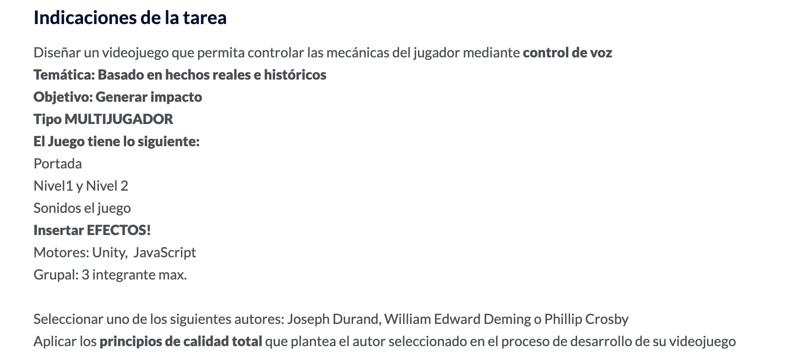

# Requisitos de la tarea

Lista de control con lo que pide el curso. Se marca cada punto cuando está **hecho y probado**.

## Qué se pide

Diseñar un videojuego que permita controlar las mecánicas del jugador mediante **control de voz**.

| #   | Requisito                                                | Cómo lo cumplimos                                                                                                          | Hecho |
| --- | -------------------------------------------------------- | -------------------------------------------------------------------------------------------------------------------------- | ----- |
| 1   | Control de voz de las mecánicas del jugador              | Deletrear palabras para lanzar poderes y para defenderse del ataque fuerte del jefe                                        | [ ]   |
| 2   | Temática basada en hechos reales e históricos            | Sitio del Callao y Fortaleza del Real Felipe (1824–1826), palabras históricas, nota final                                  | [ ]   |
| 3   | Objetivo: generar impacto                                | Cámara lenta, deletreo bajo presión, efectos y sonido, final luminoso                                                      | [ ]   |
| 4   | Tipo **multijugador**                                    | **Aplazado**: solo si el profesor lo exige, al final (ver [`decisiones-pendientes.md`](decisiones-pendientes.md), punto 9) | [ ]   |
| 5   | Portada                                                  | `EscenaPortada`                                                                                                            | [ ]   |
| 6   | Nivel 1 y Nivel 2                                        | `EscenaJuego` con los datos de cada piso                                                                                   | [ ]   |
| 7   | Sonidos del juego                                        | Sistema de audio (disparo, golpe, cofre, música, avisos)                                                                   | [ ]   |
| 8   | Insertar **efectos**                                     | Temblor de pantalla, destellos, partículas, cámara lenta                                                                   | [ ]   |
| 9   | Motor: Unity o JavaScript                                | **JavaScript** con Phaser 4 y Vite                                                                                         | [x]   |
| 10  | Grupo de 3 integrantes como máximo                       | Equipo de hasta 3 personas                                                                                                 | [ ]   |
| 11  | Elegir un autor: Joseph Durand, W. E. Deming o P. Crosby | Propuesta: **Deming** (ver [`calidad-total.md`](calidad-total.md))                                                         | [ ]   |
| 12  | Aplicar sus principios de calidad total al desarrollo    | Registro de calidad por ciclo, revisión de PR, pruebas, playtests                                                          | [ ]   |

> Sobre el autor "Joseph Durand": el nombre más conocido en calidad total es **Joseph M. Juran**.
> Hay que confirmarlo con el profesor.

## Qué no dice la tarea (y hay que preguntar)

- **¿El profesor exige el modo multijugador?** Si lo exige, se hace al final.
- **¿Se entrega solo el juego o también un informe sobre la calidad total?**
- **¿Cómo se presenta?** (demostración en clase, enlace publicado, video…).
